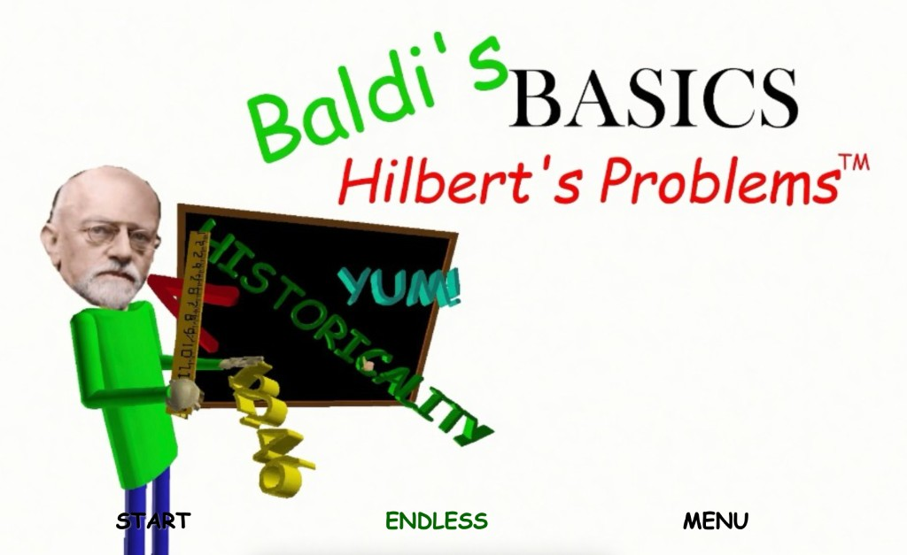

# Baldi's Basics: Hilbert's Problems



A **fan-made parody** of [*Baldi's Basics in Education and Learning*](https://basically-games.itch.io/baldis-basics) where the school’s terrifying teacher isn’t Baldi — it’s the famous mathematician **[David Hilbert](https://en.wikipedia.org/wiki/David_Hilbert)**.

Collect notebooks around the school and try to solve math problems. The easy ones are arithmetic. The hard ones are drawn from **Hilbert’s famous list of 23 problems**, posed at the [International Congress of Mathematicians in 1900](https://en.wikipedia.org/wiki/Hilbert%27s_problems) — many of which are still open, partially solved, or forever out of reach.

Can you find every notebook… and face all 23 of his problems?

> This is an unofficial fan project. *Baldi’s Basics* belongs to [Basically Games](https://www.basicallygames.com/) / Micah McGonigal. Hilbert belongs to history (and Göttingen).

## Play

```bash
cd web
nvm use 22    # Node 22+
npm install
npm run dev   # http://localhost:5173
```

Or build a static site with `npm run build` and serve the `web/dist/` folder (relative paths — works from a subdirectory).

## References

- [Hilbert’s problems](https://en.wikipedia.org/wiki/Hilbert%27s_problems) — overview of the 23 problems
- [David Hilbert](https://en.wikipedia.org/wiki/David_Hilbert) — biography
- [MacTutor: David Hilbert](https://mathshistory.st-andrews.ac.uk/Biographies/Hilbert/) — mathematical biography
- [Hilbert’s 1900 address (English translation)](https://mathcs.clarku.edu/~djoyce/hilbert/problems.html) — the original problem statements
- [*Baldi’s Basics* (itch.io)](https://basically-games.itch.io/baldis-basics) — the game this parodies
- [Basically Games](https://www.basicallygames.com/) — official studio site

## Tech notes

The playable game lives in [`web/`](web/). See [`web/README.md`](web/README.md) for controls, level editor, and architecture details.
